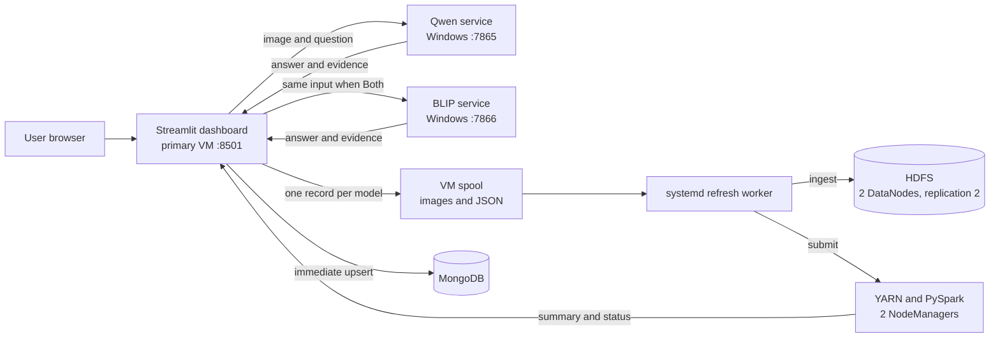

# VisionBridge BDA: implementation and rubric evidence

**Observed on 25 October 2026.** This document covers the working technical
implementation and the evidence needed to demonstrate it. Presentation and the
formal report can use these measurements later. Marks remain the examiner's
decision.

## 1. Problem statement and objective

People ask questions about photographs, packaging and printed text. A single
answer does not show whether the system read the image correctly, what OCR
evidence it used, whether it abstained, how long it took, or whether two model
families disagree. The project captures these heterogeneous requests and uses a
three-node Hadoop/Spark cluster to analyze model behavior at request scale.

**Scoped question:** For the same image and question, how do VisionBridge's
Qwen and BLIP runs differ in answer, OCR coverage, abstention and processing
time? How many submitted requests are valid or duplicated? Official VizWiz
accuracy is calculated only when the required ten human references and scoring
rules are available; answer disagreement alone is not accuracy.

The Big Data aspects are the mixture of image bytes and nested event JSON
(variety), continuous request capture (velocity), and partitioned VizWiz
annotations plus an extensible event log (volume). The present demonstration
has 14 live request records and a 9,319-row annotation selection. Those are
measured demonstration sizes, not a claim that 14 requests alone are large.

## 2. System architecture



The visible interface is one Streamlit page. Gradio is retained only as an
internal model-serving API on Windows. Qwen uses the local Ollama
`qwen3-vl:4b` model; BLIP uses the project's frozen VizWiz runtime. **Both**
submits the same uploaded image bytes and question sequentially to both
services, avoiding simultaneous GPU inference.
The page accepts a typed question, microphone recording or WAV upload, then
transcribes recorded speech and runs the selected model from one submit
button. It displays the recognized text and spoken playback for each model
answer. Existing Windows
Whisper and text-to-speech modules provide these through the internal API.
The final question text is stored with the result; recording bytes remain
temporary. A localhost SSH tunnel or WAV upload handles browsers that block
microphone access on the VM's plain HTTP LAN address.

| Component | Location | Purpose |
| --- | --- | --- |
| Streamlit and Python dashboard | Docker on primary `192.168.1.4:8501` | Upload, question, model choice, answers and analytics |
| MongoDB | Docker on primary, port 27017 | Queryable nested request records |
| NameNode and ResourceManager | Primary `192.168.1.4` | HDFS metadata and YARN scheduling |
| DataNode and NodeManager | `secondary1` at `192.168.1.2` | Replicated storage and Spark execution |
| DataNode and NodeManager | `secondary2` at `192.168.1.5` | Replicated storage and Spark execution |
| Qwen and BLIP inference | Windows `192.168.1.83` | Model processing and original evidence |

Key implementation files are `bda/dashboard.py`, `bda/model_dispatch.py`,
`bda/live_store.py`, `bda/capture.py`, `bda/ingest.py`,
`bda/live_pipeline.py`, `bda/spark_analysis.py`,
`bda/export_vizwiz_annotations.py`, `bda/spark_dataset_audit.py`,
`Dockerfile.bda` and `compose.bda.yaml`.

## 3. Request and storage flow

1. The user chooses **Qwen**, **BLIP** or **Both**, uploads an image and enters
   a question in Streamlit. The model client uploads the file to the selected
   Windows service using Gradio's `handle_file`; it never passes a VM-only path
   as though Windows could read it.
2. Each completed model call is saved separately on the primary VM before the
   next model call. A UUID `request_id` identifies the event. `image_id` is a
   SHA-256 hash of the normalized saved JPEG, and `pair_id` hashes that image
   ID with the normalized question. The same input therefore matches across
   Qwen and BLIP while retaining separate run IDs.
3. The event JSON records the image reference, question, UTC time, backend,
   model, route, OCR evidence, prediction, final answer or abstention, status,
   nested processing details and timings. The image is stored once under its
   content hash. Application failures with a valid image/question are stored
   as error records rather than fabricated answers.
   This converts an unstructured image interaction into a content-addressed
   image plus a queryable nested BSON document in MongoDB.
4. Streamlit writes the VM spool and upserts the nested event into MongoDB
   immediately. The analytics tab rereads the source every five seconds while
   open. No manual Windows-to-VM copy is needed for submissions made through
   this page.
5. `visionbridge-bda-refresh.service` watches for new event files. After the
   newest file settles for two seconds, it runs ingestion and a YARN Spark
   job. New arrivals during a job are picked up by the next pass. The worker
   retries failures and publishes `pending`, `running`, `complete` or `error`
   status to the dashboard. It can start the Hadoop controllers if their ports
   are down after a VM reboot, provided the VMs themselves are running.

The immediate Streamlit/MongoDB count and the cluster result have different
latencies. The first updates when the answer finishes; the Spark result updates
after its background job completes. The status panel shows that interval
instead of presenting an old Spark result as current.

### Example request fields

```text
request_id, pair_id, image_id, image_file, question, timestamp_utc,
run_id, backend, model, route, prediction, final_answer, status,
abstained, ocr_evidence, processing_details, timings, processing_seconds
```

VM paths:

```text
/home/admin/Desktop/BDA/project/spool/events/*.json
/home/admin/Desktop/BDA/project/spool/images/*.jpg
hdfs:///visionbridge/raw/events/*.json
hdfs:///visionbridge/raw/images/*.jpg
hdfs:///visionbridge/analytics/{rejected,duplicates,curated,summary,matched_blip_qwen}
/home/admin/Desktop/BDA/project/bda-data/analytics/pipeline_status.json
/home/admin/Desktop/BDA/project/bda-data/analytics/cluster_summary.json
```

## 4. PySpark processing and score policy

`bda/spark_analysis.py` reads the HDFS event JSON and requires nonempty
`request_id`, `pair_id`, `run_id`, `backend`, `question`, `image_id` and
`timestamp_utc`. Negative processing time is rejected. It writes rejected
rows and duplicate rows separately.

The job first deduplicates by request ID. It then keeps one event per
`pair_id` and `run_id`, so retries or multiple OCR candidates cannot inflate
the comparison. Completed BLIP and Qwen rows are joined on `pair_id`. The
request summary includes counts, OCR coverage, abstention rate, mean response
time and median response time. The matched output records both answers and
whether they differ.

If official VizWiz labels are supplied, the job requires exactly ten human
answer slots for each labelled pair and the official normalization/scoring
rules. It produces scores at **one image–question–run per row**. No official
accuracy number is shown for the current six live pairs because they do not
have matched official reference answers. The bus/package examples are useful
for error analysis, not a substitute for labelled accuracy.

## 5. Distributed dataset

The existing project's official VizWiz-VQA annotation selection was exported
from `reports/phase2_local_dev_evaluation/drive_inputs/split_manifest.json`.
The exporter validates image names, questions and ten answer slots, then hashes
rows across 32 JSONL data partitions. Its manifest records the source SHA-256
and split counts. This selection contains **annotation records only**; the
full 9,319-image corpus was not uploaded. Three images from the live requests
are stored separately under the HDFS raw image path.

The exported source manifest SHA-256 is
`6c90f77ee5c8dc54b52fca7706c58bf3f9e32bca1409d0f872039dd0439b026f`.

| Split | Rows | Answerable rows | Distinct image names |
| --- | ---: | ---: | ---: |
| Train | 5,000 | 3,652 | 5,000 |
| Dev | 1,000 | 679 | 1,000 |
| Holdout | 3,319 | 2,255 | 3,319 |
| **Total** | **9,319** | **6,586** | **9,319** |

HDFS stores 32 JSONL parts and one export manifest at
`/visionbridge/dataset/vizwiz_annotations` (6,705,413 bytes). The configured
replication factor is **2**. `hdfs fsck` reported **HEALTHY**, two DataNodes
and zero under-replicated blocks for this dataset. A YARN Spark audit returned
`raw=9319`, `valid=9319`, `rejected=0`; its application finished
**SUCCEEDED** with two running NodeManagers available. The three split rows
were exported to `bda-data/analytics/dataset_audit.json` and are visible in
the Streamlit analytics tab.

## 6. Measured live results

The following are observed results, not projections:

| Check | Result |
| --- | --- |
| Docker services | `visionbridge-bda-dashboard` and `mongodb` running |
| Dashboard health | `http://192.168.1.4:8501/_stcore/health` returned `ok` |
| Model endpoints | Qwen `:7865` and BLIP `:7866` returned HTTP 200 |
| VM spool and MongoDB | 14 request records each after an automatic test submission |
| MongoDB group query | BLIP run 6; Qwen run 8 |
| Automatic HDFS backfill | The new request's MongoDB document later contained both `hdfs_event` and `hdfs_image` references |
| Request Spark job | 14 raw, 14 valid, 0 duplicates, 14 curated, 6 matched pairs |
| HDFS raw path | 14 event JSON files and 3 content-addressed images; healthy, 0 under-replicated blocks |
| HDFS annotation selection | 33 files; healthy, 0 under-replicated blocks, 2 DataNodes |
| Dataset Spark audit | 9,319 raw, 9,319 valid, 0 rejected; YARN application succeeded |

The package and bus sample questions included visible facts, printed text,
arithmetic and unanswerable/uncertain questions. Qwen calculated that six
30 g servings equal 180 g rather than the printed 200 g net quantity; BLIP
returned only the printed 200 g field. These are qualitative observations,
not an official accuracy percentage. The full local demo output is in the
ignored `reports/bda/demo_suite_results.json` file.

## 7. Technical rubric cross-check (7 marks)

| Criterion | Marks | Evidence ready to show | Remaining qualification |
| --- | ---: | --- | --- |
| Clear Big Data problem statement | 2 | Section 1 defines the question, data types, scale path and measurable outputs. | Explain why the distributed analysis is useful; do not call the 14-request demo itself “big data.” |
| Docker and NoSQL | 2 | Dockerized Python/Streamlit app and MongoDB container; nested event upserts and actual `countDocuments`, aggregation and field queries. | Show the query result live, including a nested `processing_details` or `timings` field. |
| Streamlit UI | 1 | One interactive page for upload, question, Qwen/BLIP/Both, answer cards, request filters, metrics and refresh status. | Demonstrate a successful submission and then open the analytics tab. |
| Dataset on Hadoop/PySpark, distributed | 2 | 32 VizWiz annotation partitions, 9,319 valid Spark rows, replication 2 across two DataNodes, plus live images and events; YARN audit succeeded. | Be precise that the 9,319 records are annotations, not uploaded image files. |

The implementation has evidence for all **7 technical marks**, but no tool can
guarantee an examiner's score. If the examiner requires the entire VizWiz
image corpus rather than a distributed annotation selection and live images,
that requirement must be clarified before claiming the dataset criterion is
fully met.

## 8. Short live demonstration

1. Open `http://192.168.1.4:8501`. Select **Both**, upload one image, enter
   one question and click **Analyze image**. Show the two answer cards and
   saved request IDs.
2. Open **BDA analytics**. Request counts and the two model run rows appear
   immediately. Show the matched answer comparison. Watch the cluster status
   move through pending/running/complete; Spark may take a few minutes.
3. On the primary VM, run the following checks. The counts increase as new
   questions are submitted:

```bash
sudo docker ps --format '{{.Names}} {{.Status}}'
systemctl is-active visionbridge-bda-refresh.service
cat ~/Desktop/BDA/project/bda-data/analytics/pipeline_status.json
hdfs dfsadmin -report | grep -E 'Live datanodes|Hostname:'
hdfs dfs -count /visionbridge/raw/events /visionbridge/dataset/vizwiz_annotations
hdfs fsck /visionbridge/dataset/vizwiz_annotations -files -blocks -locations | tail -n 25
yarn node -list
hdfs dfs -cat /visionbridge/dataset-audit/by_split/part-*
sudo docker exec mongodb mongosh --quiet --eval 'const d=db.getSiblingDB("visionbridge_bda"); printjson({total:d.requests.countDocuments({}), byRun:d.requests.aggregate([{$group:{_id:"$run_id",count:{$sum:1}}}]).toArray()})'
```

The watcher log is
`~/Desktop/BDA/project/bda-data/analytics/live_pipeline.log`; service errors
are available with `journalctl -u visionbridge-bda-refresh.service -n 50`.

## 9. Reproduction and configuration

The primary VM checkout is `/home/admin/Desktop/BDA/project`. Build the
dashboard with `Dockerfile.bda`. Its container needs host networking to reach
the existing MongoDB port and Windows model endpoints, a **read-write** mount
of `spool` at `/data/spool`, and a read-only mount of
`bda-data/analytics` at `/data/analytics`. The configured dashboard image is
`visionbridge-bda-dashboard`. `compose.bda.yaml` documents the corresponding
Docker setup for a standalone local run.

The persistent cluster worker is installed on the VM as follows:

```bash
cd ~/Desktop/BDA/project
sudo cp bda/visionbridge-bda-refresh.service /etc/systemd/system/
sudo systemctl daemon-reload
sudo systemctl enable --now visionbridge-bda-refresh.service
systemctl is-active visionbridge-bda-refresh.service
```

To reproduce the distributed annotation selection from the Windows checkout:

```powershell
.\.venv\Scripts\python.exe -m bda.export_vizwiz_annotations `
  reports\phase2_local_dev_evaluation\drive_inputs\split_manifest.json `
  bda-data\vizwiz_annotations --partitions 32
scp -r bda-data/vizwiz_annotations admin@192.168.1.4:Desktop/BDA/project/bda-data/
```

On the primary VM, upload and audit it:

```bash
cd ~/Desktop/BDA/project
hdfs dfs -mkdir -p /visionbridge/dataset/vizwiz_annotations
hdfs dfs -put -f bda-data/vizwiz_annotations/part-*.jsonl /visionbridge/dataset/vizwiz_annotations/
hdfs dfs -put -f bda-data/vizwiz_annotations/export_manifest.json /visionbridge/dataset/vizwiz_annotations/
export PATH="$PWD/.venv/bin:$PATH"
export HADOOP_CONF_DIR=/usr/local/hadoop/etc/hadoop
export YARN_CONF_DIR="$HADOOP_CONF_DIR"
export PYSPARK_DRIVER_PYTHON="$PWD/.venv/bin/python"
export PYSPARK_PYTHON=/usr/bin/python3
spark-submit --master yarn --deploy-mode client \
  --conf spark.executor.instances=2 --conf spark.executor.memory=1g \
  --conf spark.executor.cores=1 bda/spark_dataset_audit.py \
  --source 'hdfs:///visionbridge/dataset/vizwiz_annotations/part-*.jsonl' \
  --output hdfs:///visionbridge/dataset-audit
```

For a standalone manual request analysis or a diagnostic rerun, use
`bash bda/vm_pipeline.sh blip-demo-v1 qwen-demo-v1 spool`. In normal use, the
systemd worker invokes that pipeline after new Streamlit captures.

## 10. Practical limits

- The Windows Qwen and BLIP services must be running for inference. The VM
  refresh worker handles analytics after a Streamlit submission; it does not
  start Windows applications.
- The VM cluster job is asynchronous. Streamlit/MongoDB metrics are immediate;
  HDFS/Spark results update after the YARN job finishes and the status panel
  confirms completion.
- Direct use of the separate Windows Gradio pages still creates Windows-local
  captures. The automatic VM path applies to submissions through Streamlit.
- The current demo has no official score for the six matched live pairs.
  Supplying a labelled VizWiz evaluation run and official rules is the next
  step if numeric accuracy is required.
