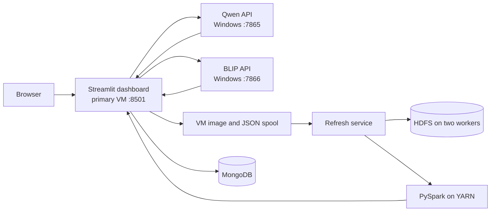

# VisionBridge: complete project and BDA operating guide

**Branch:** `bda-project`  
**Verified environment:** 25 October 2026  
**Purpose:** A working guide for the MAI application, its Big Data Analytics extension, the three-node VM deployment, and a live demonstration.

For the presentation sequence, viva answers, current measured snapshot and
report outline, see [PRESENTATION_GUIDE.md](PRESENTATION_GUIDE.md).

## 1. What the project does

VisionBridge answers questions about photographs for visually impaired users. A user uploads an image, types or records a question, selects **Qwen**, **BLIP**, or **Both**, and presses **Analyze image** once. The page returns each model's answer, optional spoken playback, processing details, and a saved request ID. A second tab shows request counts, matched Qwen/BLIP pairs, searchable history, and the latest cluster analysis.

The BDA question is: **For the same image and question, how do Qwen and BLIP differ in answer, OCR evidence, abstention, and response time, and how can these requests be validated and analyzed across a Hadoop/Spark cluster?** Image files, nested JSON evidence, and a partitioned VizWiz annotation selection give the system multiple data formats and a distributed analysis path. The current live request set is a demonstration, not a claim that a few requests alone constitute a large dataset.

The app is an academic prototype. It can give incorrect answers, especially for small print, unclear images, calculations, and questions that require facts outside the image. Answer disagreement between models is **not** an accuracy score.

## 2. Architecture and machine roles



| Machine | Current address | Roles |
| --- | --- | --- |
| Primary Ubuntu VM | `192.168.56.10` | HDFS NameNode, SecondaryNameNode, YARN ResourceManager, Dockerized Streamlit and MongoDB, Spark driver, refresh service |
| `secondary1` Ubuntu VM | `192.168.56.11` | HDFS DataNode and YARN NodeManager |
| `secondary2` Ubuntu VM | `192.168.56.12` | HDFS DataNode and YARN NodeManager |
| Windows laptop | `192.168.56.1` | Qwen/Ollama and frozen BLIP inference services, Whisper speech recognition, Windows text-to-speech |

**Stable network:** The table shows the configured VirtualBox host-only
addresses. The VM dashboard uses these model URL defaults. See
[HOST_ONLY_NETWORK.md](HOST_ONLY_NETWORK.md) for startup and verification.

The three-node cluster means **one controller VM plus two worker VMs**. HDFS replication factor 2 stores blocks on the two DataNodes. Qwen and BLIP inference remains on Windows; the VMs store records and run analytics. The primary VM script can check Windows model endpoints, but cannot start Windows processes remotely.

## 3. Start everything after a reboot

1. Start the **primary**, **secondary1**, and **secondary2** VMs. Wait for their logins and network connections.
2. On the primary desktop, open **Start VisionBridge BDA**, or run:

   ```bash
   bash ~/Desktop/start_visionbridge_bda.sh
   ```

3. The terminal starts any missing NameNode, SecondaryNameNode, DataNodes, ResourceManager, and NodeManagers. It starts the `mongodb` and `visionbridge-bda-dashboard` Docker containers and `visionbridge-bda-refresh.service`.
4. The terminal refreshes a status screen about every 12 seconds. It reports Hadoop roles, live HDFS/YARN workers, MongoDB, dashboard health, Windows Qwen/BLIP reachability, and the last Spark refresh. Press **q** or **Ctrl+C** to close only the monitor; services continue running.
5. Open `http://192.168.56.10:8501/` after the primary is running. To record
   with a browser microphone, open
   `http://127.0.0.1:8501/` in Chrome or Edge after creating the localhost
   SSH tunnel shown below.

The launcher is safe to run again: it checks each Hadoop process before starting it. It **never formats HDFS** or erases stored requests. The desktop script also supports `--status` for a one-time check and `--start-only` to start services and exit. Its version-controlled source is `bda/start_visionbridge_bda.sh`.

The Windows model services must be running for inference. The VM terminal reports **Qwen DOWN** or **BLIP DOWN** if either is unavailable. From two PowerShell windows in the Windows repository directory:

```powershell
$env:GRADIO_SERVER_NAME = '0.0.0.0'
$env:VISIONBRIDGE_BDA_RUN_ID = 'qwen-demo-v1'
$env:VISIONBRIDGE_OLLAMA_KEEP_ALIVE = '0'
.\.venv\Scripts\python.exe launch_workspace.py --backend local --port 7865
```

```powershell
$env:GRADIO_SERVER_NAME = '0.0.0.0'
$env:VISIONBRIDGE_BDA_RUN_ID = 'blip-demo-v1'
.\.venv\Scripts\python.exe launch_workspace.py --backend frozen --port 7866
```

The host-only Windows address remains fixed across Wi-Fi changes. The frozen
BLIP service requires the private runtime bundle described in
`ARTIFACT_BUNDLE_GUIDE.md`; a source checkout alone is insufficient.

### Browser microphone setup

Microphone capture requires a browser secure context. The primary VM's plain HTTP LAN address does not provide one, so the dashboard hides the recorder there and permits typed questions or WAV upload. On Windows, keep this PowerShell SSH tunnel open:

```powershell
ssh -N -L 127.0.0.1:8501:127.0.0.1:8501 admin@192.168.56.10
```

Use `http://127.0.0.1:8501/` in Chrome or Edge and allow microphone access. On the page, upload an image, **type or record** a question, and press **Analyze image** once. If both text and audio are present, typed text takes priority. The app transcribes audio before inference, displays the recognized question, and does not store raw microphone recordings. A WAV upload remains available in the optional expander.

## 4. Models and request pipeline

| Part | Implementation | Role |
| --- | --- | --- |
| Qwen | Local Ollama `qwen3-vl:4b` | General visual and printed-text questions |
| BLIP | Frozen, VizWiz-tuned BLIP runtime | Separate visual question answering baseline |
| OCR and routing | Existing EasyOCR/RapidOCR, question-aware routing and evidence policies | Extract or select printed text when the question calls for it |
| Speech input | Faster Whisper on Windows | Transcribe the recorded question before model dispatch |
| Speech output | Windows SAPI through pyttsx3 | Generate a WAV answer for each selected model |
| Streamlit | Dockerized Python dashboard on the primary | Single visible user interface, answer cards and analytics |

Streamlit calls the Windows Gradio applications as **internal APIs**. It sends image bytes through `gradio_client.handle_file`, so the Windows service receives an uploaded file instead of an unusable VM path. Selecting **Both** sends the same image bytes and question sequentially to both models. Their records share a `pair_id` but have separate `request_id` and `run_id` values. Sequential dispatch avoids simultaneous GPU inference.

The original Windows Gradio workspace remains useful for MAI development and has richer experimental routes and follow-ups. The BDA demonstration uses one Streamlit page; the Gradio pages are internal model services and are not embedded into Streamlit.

## 5. What is stored for each request

Every model call creates one immutable JSON event and an image reference. Important fields are:

| Field | Meaning |
| --- | --- |
| `request_id` | Unique UUID for this model call |
| `image_id` and `image_file` | SHA-256 content ID and saved JPEG path; identical normalized images share one image file |
| `pair_id` | Hash of image ID plus normalized question; allows fair BLIP/Qwen matching |
| `run_id`, `backend`, `model` | Experiment and model identity |
| `question`, `prediction`, `final_answer` | Submitted question, model prediction, and answer or abstention |
| `route`, `ocr_evidence`, `processing_details` | Selected route and nested evidence/processing trace |
| `status`, `abstained` | Completion/error and abstention indicators |
| `timestamp_utc` | Time the event was captured and stored |
| `processing_started_at_utc`, `processing_completed_at_utc` | Explicit model-call times for new requests |
| `processing_seconds`, `timings` | Recorded callback duration and nested stage timings |

Streamlit immediately writes JSON to `/home/admin/Desktop/BDA/project/spool/events/`, JPEGs to `spool/images/`, and upserts the document into MongoDB database `visionbridge_bda`, collection `requests`. The refresh service then copies raw images and JSON to `/visionbridge/raw/` in HDFS and adds HDFS references to MongoDB. It watches new files automatically; the user does not need to run Spark after every question.

The analytics tab rereads live records about every five seconds. **Request history** lists newest first with date/time in India Standard Time, model, question, answer, status, recorded duration, and request ID. New records use the model completion time; earlier records use their existing capture time and are labelled **Captured**. The history search filters question, answer, or ID. The result card also shows the processed date and time.

Raw images, questions, and evidence are intentionally retained for this BDA project. Use sample or authorized images. Runtime spools, private weights, and downloaded datasets are not intended for a public Git commit.

## 6. HDFS, MongoDB, and PySpark

The primary's `visionbridge-bda-refresh.service` watches the VM spool. After a new event settles, it runs `bda/vm_pipeline.sh`, which ingests events into HDFS/MongoDB and submits `bda/spark_analysis.py` using `spark-submit --master yarn --deploy-mode client`. The current Spark configuration requests two executors, 1 GB executor memory each, and one core per executor. Job status is saved to `bda-data/analytics/pipeline_status.json`; the latest summary is saved to `cluster_summary.json`. The dashboard distinguishes a pending/running refresh from completed results.

Spark requires a nonempty request ID, pair ID, run ID, backend, question, image ID, and UTC timestamp. Negative processing time is rejected. It writes invalid rows to `rejected`, duplicate request IDs or duplicate pair/run rows to `duplicates`, and deduplicated records to `curated`. Summary metrics include request counts, OCR coverage, abstention rate, and mean/median recorded response time. Completed BLIP and Qwen records are joined on `pair_id`; each image-question-run contributes at most one row.

```text
HDFS raw:       /visionbridge/raw/events and /visionbridge/raw/images
HDFS analytics: /visionbridge/analytics/rejected
                /visionbridge/analytics/duplicates
                /visionbridge/analytics/curated
                /visionbridge/analytics/summary
                /visionbridge/analytics/matched_blip_qwen
HDFS dataset:   /visionbridge/dataset/vizwiz_annotations
```

The distributed VizWiz annotation selection contains **9,319 annotation rows** (5,000 train, 1,000 dev, 3,319 holdout) across **32 JSONL partitions** plus a manifest. It was validated by a YARN Spark audit: 9,319 raw, 9,319 valid, zero rejected. This is an annotation selection, **not 9,319 uploaded image files**. Live submitted images are stored separately under the raw HDFS path.

Official VQA accuracy needs the same image/question pairs, ten original human answers per pair, and verified scoring rules. Current live questions do not supply those references. The page therefore shows answer differences and descriptive metrics, not a fabricated accuracy percentage.

## 7. Current verified state

The following is a snapshot from **25 October 2026** and will change as users submit questions:

| Check | Observed result |
| --- | --- |
| HDFS workers | 2 live DataNodes (`secondary1`, `secondary2`) |
| YARN workers | 2 running NodeManagers |
| Docker | `mongodb` and `visionbridge-bda-dashboard` running |
| Windows model endpoints | Qwen and BLIP both responded |
| Live requests | 19 valid records in VM spool, MongoDB, and HDFS |
| Latest automatic request Spark refresh | `complete` for 19 valid rows, 18 curated rows, and 6 matched pairs |
| HDFS integrity | 2 live DataNodes, 0 missing and 0 under-replicated blocks |
| Distributed annotation selection | 9,319 valid rows, 32 partitions, replication factor 2 |
| New timestamp test | Qwen answered `STOP`; its event stored both UTC start and completion times and appeared first in the IST history |

The history view and the Docker dashboard were checked after deployment. Focused Python tests for event capture, live storage, dispatch, and history passed. These are implementation checks, not a measured model-accuracy study.

## 8. Commands to verify in a viva or demo

On the primary VM:

```bash
bash ~/Desktop/start_visionbridge_bda.sh --status
hdfs dfsadmin -report | grep -E 'Live datanodes|Hostname:'
yarn node -list
sudo docker ps --format '{{.Names}} {{.Status}}'
systemctl status visionbridge-bda-refresh.service --no-pager
hdfs dfs -count /visionbridge/raw/events /visionbridge/raw/images
hdfs dfs -count /visionbridge/dataset/vizwiz_annotations
cat ~/Desktop/BDA/project/bda-data/analytics/pipeline_status.json
```

MongoDB example queries:

```bash
sudo docker exec -it mongodb mongosh visionbridge_bda
```

```javascript
db.requests.countDocuments({})
db.requests.aggregate([{ $group: { _id: "$run_id", requests: { $sum: 1 } } }])
db.requests.findOne({}, { question: 1, final_answer: 1, ocr_evidence: 1,
                          processing_details: 1, processing_completed_at_utc: 1 })
```

For a live demonstration, select **Both**, submit one sample image and question, show the two answer cards and request IDs, then open **BDA analytics**. The live history and MongoDB count update immediately; Spark changes from pending/running to complete after its YARN job. Show the two worker nodes and HDFS dataset partitions with the commands above. A single-model request also makes a good quick smoke test.

## 9. Rubric mapping

| Technical criterion | Available evidence |
| --- | --- |
| Big Data problem statement (2) | Section 1 defines the measurable image-question comparison, heterogeneous data, validation, and distributed analysis scope. |
| Docker and NoSQL (2) | Dockerized Streamlit/Python, MongoDB container, nested event documents, live queries and upserts. |
| Streamlit UI (1) | Image upload, one-submit typed or spoken question, Qwen/BLIP/Both selection, answer cards, live analytics and request history. |
| Hadoop/PySpark dataset (2) | 32 distributed VizWiz annotation partitions, 9,319 valid Spark rows, two DataNodes with replication 2, plus live raw images/events. |

These checks support the **7 technical marks**. The presentation/viva (5) and formal report (3) are separate deliverables. No document can guarantee the examiner's mark; demonstrate the actual running services and answer clearly that the VizWiz selection contains annotations, while live images are stored separately.

## 10. Troubleshooting

| Symptom | Check |
| --- | --- |
| `secondary1` or `secondary2` DOWN | Confirm its VM is booted, network IP/hostname is correct, and passwordless SSH from the primary works; rerun the launcher. |
| Fewer than two HDFS DataNodes | Run `hdfs dfsadmin -report`; inspect `jps` over SSH on each worker. Do not format the NameNode. |
| YARN NodeManager DOWN | Run `yarn node -list` and `ssh admin@secondary2 jps` (or `secondary1`). |
| Dashboard DOWN | Run `sudo docker ps -a`, `sudo docker start mongodb visionbridge-bda-dashboard`, and `curl http://127.0.0.1:8501/_stcore/health` on the primary. |
| Qwen/BLIP DOWN in monitor | Start the missing Windows service, confirm Windows IP/ports, and ensure Windows firewall permits the VM connection. |
| Microphone error on LAN URL | Use the localhost SSH tunnel and Chrome/Edge, or type a question/upload WAV. |
| Requests show but Spark is pending | Wait for the background job; inspect `systemctl status visionbridge-bda-refresh.service` and `bda-data/analytics/live_pipeline.log`. |
| No matched pair | Submit the **same image bytes and same question** to Both models; two different questions or images generate different pair IDs. |

## 11. Source map

| File | Purpose |
| --- | --- |
| `bda/dashboard.py` | Streamlit interface, result cards, analytics, history and five-second refresh |
| `bda/model_dispatch.py` | Qwen/BLIP API calls, voice transcription call, spoken answer transfer, model start/completion times |
| `bda/capture.py` | Request/pair/image IDs and JSON/JPEG capture |
| `bda/live_store.py` | Immediate VM spool write and MongoDB upsert |
| `bda/ingest.py` | HDFS import and MongoDB HDFS references |
| `bda/live_pipeline.py` | Continuous refresh watcher, status and Spark submission |
| `bda/spark_analysis.py` | Validation, deduplication, run summaries and paired comparison |
| `bda/export_vizwiz_annotations.py` / `bda/spark_dataset_audit.py` | Distributed annotation preparation and audit |
| `bda/start_visionbridge_bda.sh` | Primary VM desktop start and terminal status monitor |
| `Dockerfile.bda` | Streamlit container build |
| `BDA_GUIDE.md` and `BDA_RUBRIC_EVIDENCE.md` | Detailed commands and rubric evidence |
| `README.md` and `docs/USER_MANUAL.md` | MAI workspace features, setup and user guidance |

The repository is on branch `bda-project`. The primary VM deployment lives at `/home/admin/Desktop/BDA/project`; its desktop launcher and script live directly in `/home/admin/Desktop/`.
