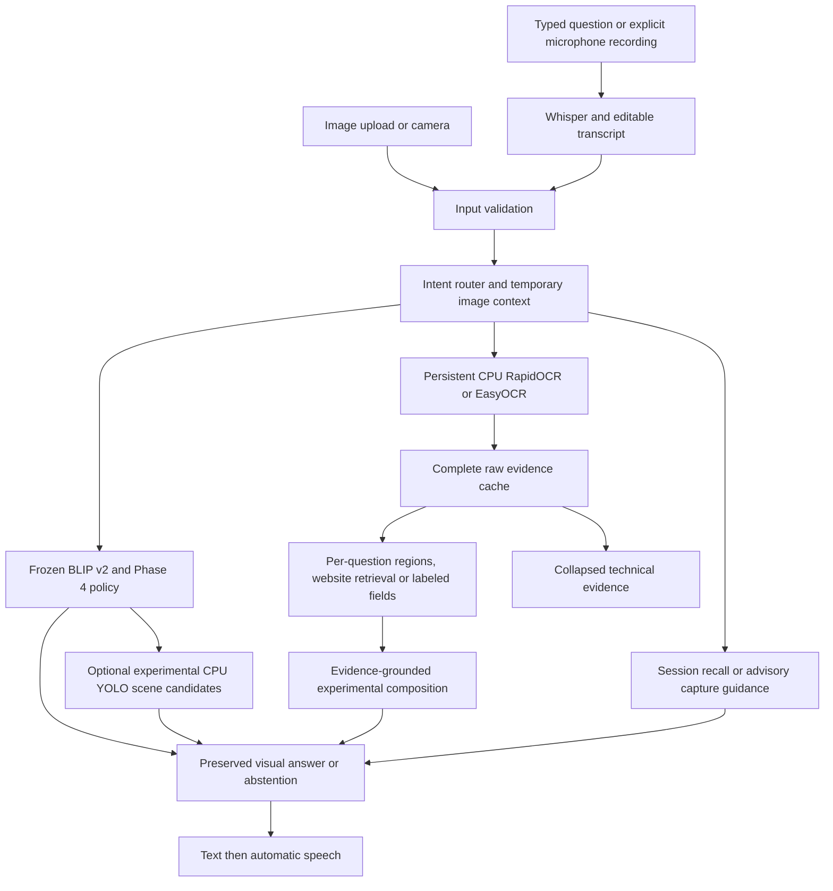

# VisionBridge — Multimodal AI Assistant for Visually Impaired Users

This `mlops-ese` branch contains the AWS MLOps deployment. See the
[MLOps overview](../../mlops/README.md), [AWS deployment record](../../mlops/aws/DEPLOYMENT.md),
and [presentation guide](../../mlops/PRESENTATION.md). The public workspace runs at
[https://15-135-22-228.sslip.io/](https://15-135-22-228.sslip.io/).

VisionBridge is a university AI/ML accessibility prototype that answers questions about images and reads question-relevant printed text. It combines a fine-tuned BLIP model with visual evidence, conservative answer-or-abstain decisions, and an experimental voice-first workspace.

Blind and visually impaired users may need a scene description, a label reading or a specific printed field from the same photograph. These tasks need different evidence. VisionBridge routes questions automatically and keeps uncertainty visible rather than guessing missing information.

## Problem statement and objectives

Photographs, packaging, signs and documents often contain information that is difficult to access without sight. Small print, poor focus and incomplete visual context make an unsupported answer especially unhelpful. VisionBridge is an academic prototype for exploring accessible access to this information; it is not a validated assistive device.

The objectives are to answer visual questions, read supported text, provide voice input/output, preserve evidence for decisions, support contextual follow-ups, and offer useful capture guidance when evidence is insufficient. These objectives are implemented with conservative limitations described below.

## Features and project contributions

- Frozen BLIP v2 VQA with preserved Phase 2–4 evidence/gating policies.
- Separate retained EasyOCR and RapidOCR CPU readers, orientation correction and question-aware region selection.
- Experimental task-specific quality hints, guided retake and explicitly labeled field extraction.
- Experimental evidence-aware follow-up conversations: upload once, ask multiple questions, reuse raw evidence and clarify ambiguous references.
- Whisper transcription review, automatic spoken answers, mute, Play Answer, selectable/copied text and a navy Gradio workspace.
- Complete raw evidence, source IDs, selected/excluded candidates, boxes and stage traces in collapsed Technical Details.
- Cooking-step and paragraph selection, next/back navigation, ingredient mentions and literal word-presence questions. Layout-supported blocks are not presented as verified printed step numbers.
- Session-only recall of exact earlier questions and answers. The last 60 non-recall questions are retained separately from the six visible exchanges, with the existing 30-minute image-context expiry.
- Experimental serving-size, calorie and net-quantity extraction when explicit labels and a unique supported value are available. Serving size is never used as package weight.
- Experimental scene overviews supplement a successful frozen VQA answer with existing CPU YOLO candidates. They do not override a frozen abstention or constitute a verified object inventory.

See the system architecture and known limitations directly below. Experimental features have no new official VQA accuracy claim. Historical local validation reports are not required public documentation; current measured checks are summarized here.

## Launch on the configured laptop

For this source checkout, the main workspace uses a local Ollama vision model.
It accepts image questions across subjects, including printed labels, documents,
charts, translation and calculations. It does not require the private Phase 4
bundle. Answers are generated and can contain errors; verify important details.
Install [Ollama](https://ollama.com/) and download the model once:

```powershell
ollama pull qwen3-vl:4b
```

From the project directory, use one workspace at a time:

```powershell
.\.venv\Scripts\python.exe launch_workspace.py --backend local --port 7865
```

Open `http://127.0.0.1:7865`. Stop an older workspace with Ctrl+C in its terminal before restarting; duplicate GPU workers can exhaust a 4 GB GTX 1650. Source guards must remain enabled.

The model runs on this computer through `127.0.0.1:11434`; this path does not
send images to a cloud API. Initial model loading and CPU inference can be slow.
Follow-up questions retain the last six exchanges for the same image and browser;
changing the image or clearing the session resets that context.

`--backend frozen` selects the historical Phase 4 application and requires its
private model/policy bundle plus `.venv-gpu`. `--backend auto` selects that
backend only when its runtime files exist, otherwise it selects the local
vision model. The historical feature/evaluation descriptions below refer to the
Phase 4/experimental research pipeline, not measurements of the new local model.

If that port is occupied, use `--port 7866` and open `http://127.0.0.1:7866/`. Run from the checkout root. Restart after source edits so initialized workers can reverify their protected files.

Upload/capture an image and type or transcribe a question. Select **Analyze Image**. Text appears first, followed by one generated audio response. Speech is enabled by default. If autoplay is blocked, press **Play Answer**; mute disables synthesis for subsequent requests. Microphone and camera activation are explicitly user-controlled.

Ask follow-ups without re-uploading the image. **Clear image, question and conversation** clears active context. See the [detailed user manual](../../docs/USER_MANUAL.md).

| Request | Route |
|---|---|
| What is in this image? | Frozen visual answer or abstention |
| Read the passage | Main recognized passage |
| Detect every text | Accepted text from all regions |
| What is website in the image? | Qualified visible domain evidence |
| What is the URL? | Observed URL or supported partial answer |
| What happened in the passage? | Recognized passage quotation |
| Explain that / Read the rest | Grounded context resolution or clarification |
| What is the expiry date? | Experimental explicit label/value extraction |
| What exact product is this? | Printed product/brand evidence, otherwise abstention |
| Read the second cooking step | One supported detected instruction block |
| Repeat the previous step | Repeat the last selected step; does not navigate backward |
| Go back one step | Move the instruction cursor backward |
| What ingredients are mentioned? | Recognized ingredient section or qualified preparation mentions |
| What is the serving size? | Explicit printed label/value evidence |
| How can I take a clearer picture? | Advisory image-quality guidance without BLIP |
| What was my second question? | Exact available session question; no inference |

Advanced / Developer retains manual Visual Q&A, original Experimental OCR Reading, Full Text Reading, rotation and engine overrides. The original conservative EasyOCR policy remains 0.90. The experimental full-line RapidOCR acceptance remains its pre-existing 0.75; neither is a calibrated correctness probability.

## Installation and model setup

This section is the main developer setup reference. **A fresh installation on another computer has not yet been verified.** Commands have been reviewed against the working laptop and repository, but dependency checks and source-only tests are not a clean-machine installation test. Do not recreate or upgrade the already working laptop environments.

Open PowerShell in the checkout root. The repository already tracks an original BLIP checkpoint with Git LFS; it is unchanged and is not needed by explicit v2 inference. A normal LFS-enabled clone may download it. The private v2 runtime bundle below is still required. Do not delete the original checkpoint or disable integrity checks as a setup shortcut.

A source checkout alone is insufficient. Obtain the trusted private [21-file runtime bundle](../../docs/research/ARTIFACT_BUNDLE_GUIDE.md): BLIP v2 and processor, classifier heads, frozen policies/integrity metadata, and existing EasyOCR/YOLO weights. Installation refuses conflicting destinations. The optional EasyOCR worker reuses verified bundled weights and never silently downloads a replacement. `setup_full_text.ps1` prepares the isolated CPU ONNX reader and its hash-verified English recognizer. Whisper may require an initial model download; Windows speech needs an installed SAPI voice.

### New Windows checkout: quick setup

Use Windows 11 and Python 3.11 (the tested laptop uses 3.11.9), an NVIDIA driver compatible with CUDA 12.1, and sufficient storage for three environments and private assets. The tested GTX 1650 has approximately 4 GB VRAM. This launch path requires CUDA for frozen VQA; it has no silent CPU BLIP fallback. Do not run these creation/install steps over an already configured environment.

```powershell
py -3.11 -m venv .venv
.\.venv\Scripts\python.exe -m pip install -r requirements-final-ui.txt
py -3.11 -m venv .venv-gpu
.\.venv-gpu\Scripts\python.exe -m pip install torch==2.5.1 torchvision==0.20.1 --index-url https://download.pytorch.org/whl/cu121
.\.venv-gpu\Scripts\python.exe -m pip install -r requirements-final-gpu.txt
.\.venv-gpu\Scripts\python.exe -c "import torch; print(torch.__version__); print(torch.cuda.is_available())"
```

For an RTX 50-series GPU, use a separate Python 3.12 environment with
`torch==2.7.1` and `torchvision==0.22.1` from
`https://download.pytorch.org/whl/cu128`, then install the same
`requirements-final-gpu.txt`. This laptop's RTX 5060 requires that newer CUDA
build. The checkpoint, policies and source integrity checks remain the same;
this hardware/runtime combination does not reproduce the recorded GTX 1650
benchmark environment. OCR uses the separate `.venv-ocr` environment.

### Restore the private runtime assets

Obtain the **private 21-file runtime bundle** from the project owner through an approved private arrangement. This repository does not expose its contents, credentials, private download URL or a public asset download. A source checkout alone cannot launch frozen VQA. The trusted bundle supplies BLIP v2/processor, classifier heads, frozen policy/integrity metadata and existing OCR/YOLO assets. Its private annotation/development metadata must not be committed or uploaded to a public PR.

Save the privately obtained ZIP locally as `private-artifacts/VisionBridge-runtime.zip`. The path is a local placeholder, not a download location. Confirm the expected checksum with the owner before loading it:

```powershell
$artifactZip = (Resolve-Path '.\private-artifacts\VisionBridge-runtime.zip').Path
$runtimeSha = '933acfb18a8bfd3afaf4e15dd7fa760491beeaf5ba76216ee764e175b0ace2fc'
Get-FileHash -LiteralPath $artifactZip -Algorithm SHA256
.\.venv\Scripts\python.exe artifact_bundle.py verify --archive $artifactZip --project (Get-Location).Path --expected-sha256 $runtimeSha
.\.venv\Scripts\python.exe artifact_bundle.py install --archive $artifactZip --project (Get-Location).Path --expected-sha256 $runtimeSha
```

The installer validates archive members and source hashes, skips identical existing destinations and refuses different existing files. Do not force an overwrite or load untrusted joblib classifier files. The [artifact specification](../../docs/research/ARTIFACT_BUNDLE_GUIDE.md) documents the reviewed bundle and its verification boundaries; access must be arranged separately.

### Set up CPU OCR and check dependencies

```powershell
.\setup_full_text.ps1
.\.venv\Scripts\python.exe -m pip check
.\.venv-gpu\Scripts\python.exe -m pip check
.\.venv-ocr\Scripts\python.exe -m pip check
```

`setup_full_text.ps1` creates `.venv-ocr` if needed, installs its pinned lock and verifies/downloads the approved English ONNX recognizer. It does not replace CUDA Torch or overwrite a conflicting recognizer. EasyOCR and experimental CPU scene detection reuse the verified bundle's existing model-cache assets. Whisper may need an initial model download; Windows SAPI needs an installed voice. No environment variable is required for the default relative-path workspace.

### Setup troubleshooting

- Stop if CUDA is unavailable. Check the NVIDIA driver, `.venv-gpu` interpreter and CUDA Torch pair; frozen BLIP has no silent CPU/older-model fallback.
- Do not mix `requirements.txt`, historical Colab profiles and the final Windows profiles. The saved classifier needs its pinned scikit-learn version. Use separate environments.
- Missing runtime files require the matching trusted bundle. A changed-source error requires the matching source checkout and a worker restart, not disabling checks. Preserve LF bytes for protected sources.
- Camera/microphone permission, available Windows speech voices and browser autoplay are separate from CUDA. Typed questions remain available; speech failure should not remove a text answer.
- Run one GPU interface at a time on a 4 GB card. Cold startup and OCR fallback can be slow. Stop with Ctrl+C in the launching terminal before switching interfaces.
- A runtime-only bundle does not include every historical testing fixture. Do not substitute examples or regenerate the original splits to make a historical test pass.

| Component | Tested technology |
|---|---|
| Visual VQA | Salesforce BLIP VQA base, fine-tuned on VizWiz |
| Evidence | EasyOCR 1.7.2, RapidOCR ONNX Runtime 1.4.4, existing question-triggered YOLOv8n |
| Reliability | Saved lightweight scikit-learn classifiers, version 1.9.1 |
| Speech and UI | Faster Whisper, Windows SAPI/pyttsx3, Gradio 6.13.0 |
| Execution | Python 3.11; BLIP on CUDA, OCR/YOLO on CPU |

The final profiles also pin Transformers **4.46.3**, Faster Whisper **1.2.1** and pyttsx3 **2.99**. The GPU Torch pair is installed separately as shown above. Versions are taken from the repository profiles and existing environments; a fresh-machine dependency resolution has not been tested in this preparation task.

## System architecture



BLIP uses vision-language cross-attention, an intermediate-fusion-style approach. OCR is a separate evidence decision layer, not text appended arbitrarily to the BLIP question. The unified assistant adds experimental routing/composition around frozen inference. It cannot recover a rejected frozen visual answer by inventing a description. A qualified domain identifies visible OCR evidence, not necessarily the active browser website.

## Methodology and verified results

The original run02 manifest fixes **5,000 training**, **1,000 development** and **3,319 held-out** examples. The holdout is a reserved portion of VizWiz validation, not the official VizWiz test set. BLIP fine-tuning completed five epochs on Colab T4; the best development checkpoint was selected. Classifiers were fitted on training data only. OCR policy changes and classifier/threshold selection used development data. The final policy and protocol were frozen before the single final holdout capture. No later training or holdout tuning occurred.

Official VQA agreement uses all ten original annotator slots, preserving reference frequencies and official prediction normalization. It is a soft agreement metric, not binary answer accuracy. `unanswerable` outputs can earn agreement; therefore report answer coverage and recall alongside VQA.

| Stage / configuration | Dataset | N | Official VQA agreement |
|---|---|---:|---:|
| Phase 1 pretrained BLIP | Historical Colab holdout | 3,319 | 21.60% |
| Phase 1 existing fine-tuned BLIP | Historical Colab holdout | 3,319 | 55.38% |
| Phase 1 improved BLIP v2 | Historical Colab holdout | 3,319 | 59.48% |
| BLIP v2 development control | Original development | 1,000 | 59.05% |
| Frozen Phase 2 OCR | Original development | 1,000 | 59.15% |
| Phase 3 answerability-only, A=0.90 | Original development | 1,000 | 60.32% |
| Phase 3 both gates, A=0.90/R=0.25 | Original development | 1,000 | 60.70% |
| Phase 4 balanced, A=0.00/R=0.05 | Original development | 1,000 | 59.31% |
| BLIP v2 shared final control | Final Windows holdout | 3,319 | 58.72% |
| Frozen Phase 2 shared final control | Final Windows holdout | 3,319 | 58.75% |
| Frozen Phase 4 final system | Final Windows holdout | 3,319 | **58.89%** |

Phase 3's higher development agreement came with lower answerability recall (43.74%) and coverage (31.70%). Phase 4 prioritizes a balance: development recall **57.44%**, coverage **42.90%**. On holdout, final precision/recall/F1 are **90.50% / 60.00% / 72.16%**, answer coverage **45.04%**, abstention **54.96%**. These classification metrics describe returning an answer for an answerable-labelled question; they do not measure the factual correctness of that answer.

The final paired gain over its shared Phase 2 control is **0.1386 percentage points**, without a significance claim. It does **not** establish an improvement over historical 59.48%. The archived Colab predictions reproduce **59.4848%**; current saved BLIP predictions reproduce **58.7225%**. IDs, questions, references and checkpoint/processor export hashes match. There are 237 changed normalized answers (40 beneficial, 77 harmful, 120 neutral). Colab used batch size 4, Torch 2.11.0+cu130, Transformers 4.57.6 and a T4; Windows used batch size 1, Torch 2.5.1+cu121, Transformers 4.46.3 and a GTX 1650. These verified differences do not isolate the cause. Keep both results with their provenance; no holdout rerun was used in the investigation.

See [the public submission results and provenance](../../submission/RESULTS_AND_PROVENANCE.md) and its comparison/confusion plots. Detailed local reports, freeze files and per-example artifacts remain in the separately preserved artifact bundle under `reports/`; they are excluded from the proposed Git commit. Recorded holdout component latency was **7.769 s/example**, peak allocated GPU memory **2,107.7 MiB**; this excludes cold application startup.

The [16 October discrepancy update](../../docs/research/BASELINE_DISCREPANCY_UPDATE.md) identifies a concrete batching confound: both inspected BLIP versions give the decoder an all-ones question-state mask even when encoder inputs were padded. A synthetic tokenizer check confirmed extra positions under batching. This is a plausible contributor, not proof of the cause of all 237 changed predictions. No holdout inference or frozen-result edits were used to investigate it.


## Repository structure

```text
VisionBridge/
├── launch_workspace.py           # unified opt-in assistant
├── workspace_ui.py               # Gradio presentation and safe response handling
├── workspace_intent.py          # deterministic task routing
├── image_conversation.py        # per-image context and cache reuse
├── conversation_recall.py       # earlier question/answer retrieval
├── text_hierarchy.py            # paragraphs, detected steps and navigation
├── reading_relevance.py         # OCR region selection and bounded overviews
├── ingredient_reading.py        # literal ingredient/word mentions
├── assistive_tools.py           # quality hints and explicit printed fields
├── experimental_scene*.py       # existing CPU YOLO candidate supplement
├── full_text_session.py         # persistent OCR orchestration
├── workspace_voice.py           # microphone payload checks/transcription review
├── workspace_speech.py          # automatic speech and long-text chunking
├── modules/                     # model, evidence and classifier components
├── utils/                       # checkpoint loading and image utilities
├── docs/USER_MANUAL.md          # detailed end-user instructions
├── assets/workspace/            # CSS and SVG UI assets
├── tests/                       # unit, regression and integration checks
├── submission/                  # reviewed public provenance/preparation materials
├── models/                      # local checkpoints; source alone is insufficient
└── reports/                     # private local runs/data/cache, ignored by Git
```

| Files | Purpose |
|---|---|
| `launch_workspace.py`, `workspace_ui.py` | Unified Gradio presentation |
| `image_conversation.py`, `website_evidence.py` | Session follow-ups and qualified website retrieval |
| `reading_relevance.py`, `assistive_tools.py` | Experimental selection, quality and labeled fields |
| `full_text_session.py`, `full_text_worker.py`, `easy_reading_worker.py` | Isolated persistent OCR workers and adapters |
| `persistent_demo_worker.py`, `persistent_demo_client.py` | Preserved frozen GPU transport |
| `phase4_pipeline.py`, `phase4_gpu_infer.py`, `app_phase4.py` | Frozen application/policy integration |
| `modules/`, `utils/` | Original model loading, inference, evidence and gates |
| `notebooks/mai_model_train_improved.ipynb`, `visionbridge_training.py` | Preserved training workflow; not run during assistant development |
| `tests/`, `submission/` | Regression tests and small curated submission materials |
| `models/`, `reports/` | Local/private runtime artifacts; not a source-only setup |

## Testing and performance

```powershell
.\.venv\Scripts\python.exe -m pytest tests -q --ignore=tests/test_answerability_gate.py --ignore=tests/test_phase3_dev.py
.\.venv-gpu\Scripts\python.exe -m pytest tests/test_answerability_gate.py tests/test_phase3_dev.py -q
```

Install test-only pytest tooling in a fresh UI environment if needed; do not replace neural dependencies. Tests use mocks, permitted synthetic fixtures and integrity checks, not a new holdout evaluation. The dedicated `scripts/validation/validate_image_conversation.py` and `scripts/validation/validate_followup_final.py` tools use permitted local manual fixtures and produce new reports; their saved-visual replay is explicitly labeled. They are not general dataset benchmarks.

Recorded 21 October validation: **428 regression tests and 45 subtests passed**, plus **14 classifier tests**. There were 32 initial native five-image HTTP callback completions; later checks used saved OCR/BLIP evidence and separately identified real CPU YOLO/TTS. These counts are not OCR accuracy or accessibility certification. Frozen Phase 2–4 integrity checks passed. Preparation source-only checks on 22 October passed 27 tests and 40 subtests; those are a separate, narrower scope.

Many complete-suite tests require ignored private manifests, freeze files and saved manual fixtures. A source-only checkout cannot reproduce those checks without the separately supplied artifacts, and some historical fixtures are not in the runtime-only bundle. Do not substitute data or regenerate splits. For a source-only check using installed UI/test dependencies and no model inference:

```powershell
.\.venv\Scripts\python.exe -m pytest tests/test_workspace_intent.py tests/test_workspace_speech.py tests/test_artifact_bundle.py -q
```

The recorded copied-tree check passed 27 tests and 40 subtests. Artifact tests use temporary fake payloads, not real checkpoints. `pytest>=8,<10` is test-only tooling for a fresh UI environment; subtest support must match the installed pytest setup. This check does not validate model loading, private fixtures, hardware or a new-machine installation.

API latency is not browser rendering or audio duration. Cold initialization, CPU OCR fallback and speech can substantially increase end-to-end response time. Cached recall often takes around 1–4 seconds over HTTP in the recorded local checks, but different tasks and mute settings are not comparable benchmarks. Persistent initialization/caching is enabled in the experimental workspace, while original frozen launchers remain unchanged.

Other retained entry points: `launch_phase4.py`, `launch_submission.py`, `launch_reading_demo.py`, `launch_persistent_demo.py`, `launch_orientation_workspace.py` and `launch_full_text_workspace.py`. Run them with the documented `.venv` interpreter, one GPU interface at a time.

## Known limitations, privacy and responsible use

- OCR can omit, join or misrecognize text, especially curved labels, glare, small print and mixed layouts. Missing characters are not invented. Known rendered-text results are not real-photo accuracy.
- Summaries are explicitly extractive; unsupported semantic questions clarify or abstain. Many answerable visual questions are still declined. No experimental assistant holdout gain is claimed.
- A summary is a bounded reading-based overview of up to six physical OCR lines, not a reliable semantic explanation. Joined OCR words and missing content are not repaired by guessing.
- Dense soup-label ingredients and net quantity were not recovered in the recorded test. Serving size was recovered; ambiguous calorie-column values abstained. Missing text is not proof that an ingredient or allergen is absent.
- CPU YOLO scene candidates may be incomplete or wrong; the living-room check included a questionable TV candidate. This is not a verified detailed scene description or safety/navigation aid.
- Quality scores and classifier outputs do not prove correctness or product safety. This prototype is not a verified aid for medication or hazards.
- Conversation history is bounded and browser-scoped. Raw OCR/speech worker files are temporary. **Original frozen VQA callbacks still retain private request images/logs and evidence caches under ignored `reports/`. Reset does not delete preserved artifacts.** Do not publish these files or the private runtime bundle.
- Engine overrides are workspace-wide in this local single-user prototype. It is not a production multi-user service. Camera/microphone access remains explicit; mute is browser-session scoped where storage is available.
- Browser autoplay, physical microphone/camera, audible speech, keyboard-only use and screen-reader behavior require human verification. Follow [MANUAL_TEST_CHECKLIST.md](../../docs/research/MANUAL_TEST_CHECKLIST.md); backend tests do not certify accessibility.

## Future improvements

- Evaluate dense and curved-label text recognition on annotated real photographs before adopting extra OCR passes or changing experimental policies.
- Assess lightweight, evidence-verified semantic summarization; no new summarization model is currently implemented.
- Improve verification of scene-detector candidates and measure latency/coverage alongside answer quality.
- Add production retention controls and validate keyboard, speech and screen-reader workflows with intended users.
- Use independent development/evaluation data for future methods. The completed holdout must not become a tuning set.

## Contribution and reproducibility boundaries

Keep datasets, private runtime bundles, request recordings/images, caches, credentials and generated logs out of source changes. Preserve frozen checkpoints, thresholds and recorded results. Changes to experimental assistant behavior need their own tests and clearly separated evaluation claims. The original tracked LFS checkpoint and sample files remain unchanged; repository licensing and unresolved sample provenance still need team decisions. See [sample provenance](../../docs/research/SAMPLE_PROVENANCE.md).

## Screenshots

Actual local UI screenshots exist, but none has been newly approved for public publication in this preparation. No private image, synthetic substitute or unapproved screenshot is embedded. Add only an approved, reviewed UI capture with a relative repository path.
