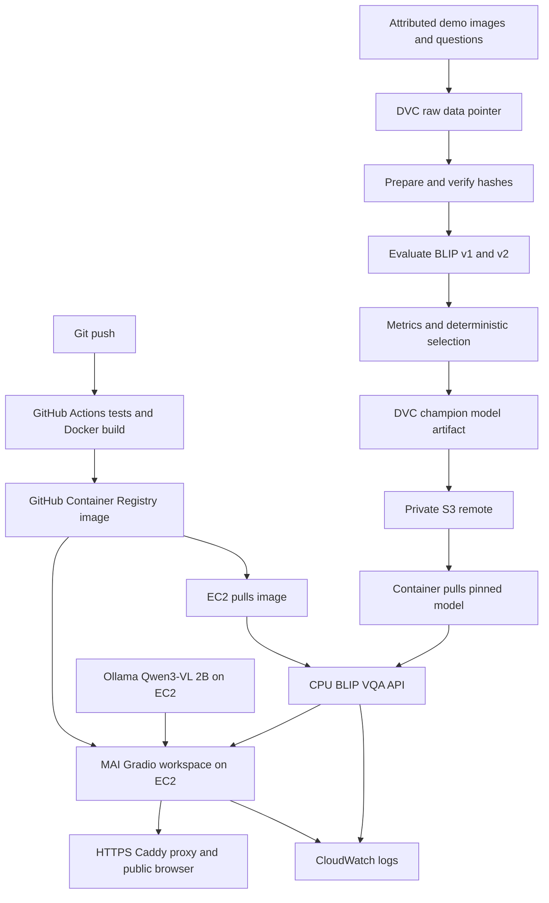

# VisionBridge MLOps course implementation

This directory implements the professor's data → pipeline → experiments → selected model → DVC remote → Docker API → container registry → EC2 flow. The public frontend is the VisionBridge workspace from the `mai-project` branch (source commit `eb1fc3d`), adapted so inference runs on EC2. The AWS project uses `ap-southeast-2`. The Agent Toolkit control service runs in `us-east-1`; application resources stay in `ap-southeast-2`.

## What is measured

The 16 locally authored demo questions and four attributed images are a **pipeline and serving demonstration**. Thirteen have reference answers. The two existing BLIP checkpoints each matched 10/13 references using simple normalized exact match. This small set is not VizWiz and does not estimate real-world VQA accuracy. The selected BLIP v2 checkpoint won the declared tie rule. The earlier official VizWiz results and their caveats remain in `submission/RESULTS_AND_PROVENANCE.md`; they are not recomputed or relabeled here.

## Architecture



## Local reproduction

Use a Python environment with DVC 3.67.1, Pillow, CPU or CUDA Torch, Transformers 4.46.3, tokenizers 0.20.3, and safetensors. The existing `.venv-gpu` inference environment supplies the neural dependencies locally; DVC is installed separately. Activate an environment containing the neural dependencies before running DVC stages.

```powershell
$env:Path = (Join-Path (Get-Location) '.venv-gpu\Scripts') + ';' + $env:Path
dvc repro
dvc status
dvc metrics show
```

`dvc.yaml` has five stages: `prepare`, `evaluate_v1`, `evaluate_v2`, `select`, and `register`. Raw images and BLIP v2 are DVC tracked. BLIP v1 remains in Git LFS. The lock file records exact dependency and output hashes. To compare changed pipeline versions later, run `dvc exp run` and `dvc exp show`; keep experiments based on the same data before drawing a model comparison.

The selected artifact is `mlops/registry/champion`, including `registry.json`. It contains the model, processor, selection rule, and source hashes. The deployment image contains code only; `mlops/serve.sh` pulls the pinned artifact from S3 on startup. No AWS keys are stored in Git or Docker.

## API

Open the [public HTTPS workspace](https://15-135-22-228.sslip.io/) to upload or capture an image, ask a question, use follow-ups, and choose the cloud model. The default is the DVC-selected BLIP champion on EC2; Qwen3-VL 2B is an optional model for broader questions. Choosing Qwen manually overrides the default for that browser session. Voice transcription uses Whisper tiny.en and speech output uses the Linux speech engine in the workspace container. The CPU BLIP API also exposes `GET /health`, `POST /predict`, and `GET /metrics`. Prediction accepts JSON:

```json
{"question":"What word is on the sign?","image_base64":"<base64-encoded image>"}
```

It returns the answer, selected BLIP candidate and model hash, and latency. The image and question are not logged; logs contain only result timing, model hash, and errors. The API, workspace, and Ollama endpoints bind to localhost on EC2; Caddy exposes the workspace and BLIP API through HTTPS ports 80/443. SSM remains an operator access path. The private frozen Phase 4 OCR/gating bundle is not in this cloud deployment. Qwen answers reading questions directly; those answers have no independently verified OCR boxes or calibrated accuracy claim.

## AWS deployment

The private S3 bucket `visionbridge-mlops-20261026-1a167b3` holds DVC objects. GitHub Container Registry holds immutable code image tags for both the BLIP API and MAI workspace. One `m7i-flex.large` CPU EC2 instance hosts them and Ollama in `ap-southeast-2` with 8 GiB RAM. The Qwen3-VL 2B Ollama weights are downloaded to a persistent Docker volume on that EC2 host. The instance profile provides S3/SSM/CloudWatch access with IMDSv2 hop limit 2. Public ingress is limited to ports 80 and 443 for the HTTPS proxy; inference ports 8000, 7865, and 11434 stay local. The AWS Free Plan's managed policy blocks creating an ECR private repository, CodeBuild, CodePipeline, CloudFormation stacks, and IAM OIDC providers, so GitHub Actions and GHCR provide the CI and image registry.

GitHub Actions validates on pushes to this branch, builds and pushes the image using its built-in GitHub token, then deploys on a narrowly labeled self-hosted runner on the EC2 demo instance. The container restarts automatically. Deployment waits for `/health` and can restore the previous local image after a failed health check. No static AWS keys are placed in GitHub. Pull requests do not run on the self-hosted runner because this is a public repository.

For the presentation, open the MAI workspace above, upload the supplied stop-sign image, and ask “What word is on the sign?” Show both cloud model choices, the pipeline artifacts, and the latest successful deployment. See the deployment guide for resource IDs, evidence, and operator access.

## Rubric evidence

| Rubric item | Evidence to show |
|---|---|
| Cloud services and MLOps | Private S3 remote, GHCR image, EC2 instance, IAM role |
| Pipeline and CI/CD | `dvc.yaml`, `dvc.lock`, successful `dvc repro`, GitHub Actions runs |
| Tracking, monitoring, optimization | Both metric JSON files, selection manifest, `/metrics`, CloudWatch logs, measured latency |
| Documentation and presentation | This architecture, deployment record, screenshots in `ss/`, demo request and rollback |
| Viva | Explain Git vs DVC vs GHCR versions, fixed data split, CPU deployment limits, and cost controls |

## Cost and cleanup

The AWS project has Free Plan credits, but EC2, its EBS volume, S3 storage/requests, public IPv4, and logs consume them. The public link works while the instance runs. Stop the instance between demos; the Elastic IP remains allocated and can still incur charges. Terminate the instance and release the Elastic IP when finished. Delete old unneeded GHCR images and S3 DVC objects only after confirming the artifacts are no longer required. Keep the private bucket blocked from public access. Review AWS Settings billing and Free Tier usage during the project.
