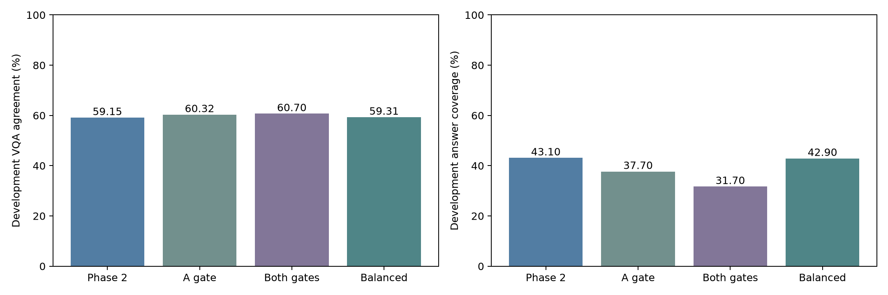
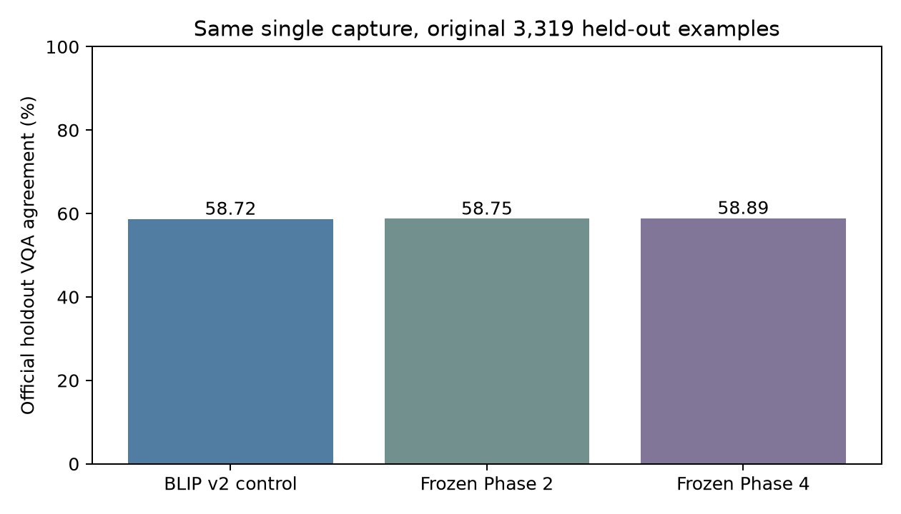
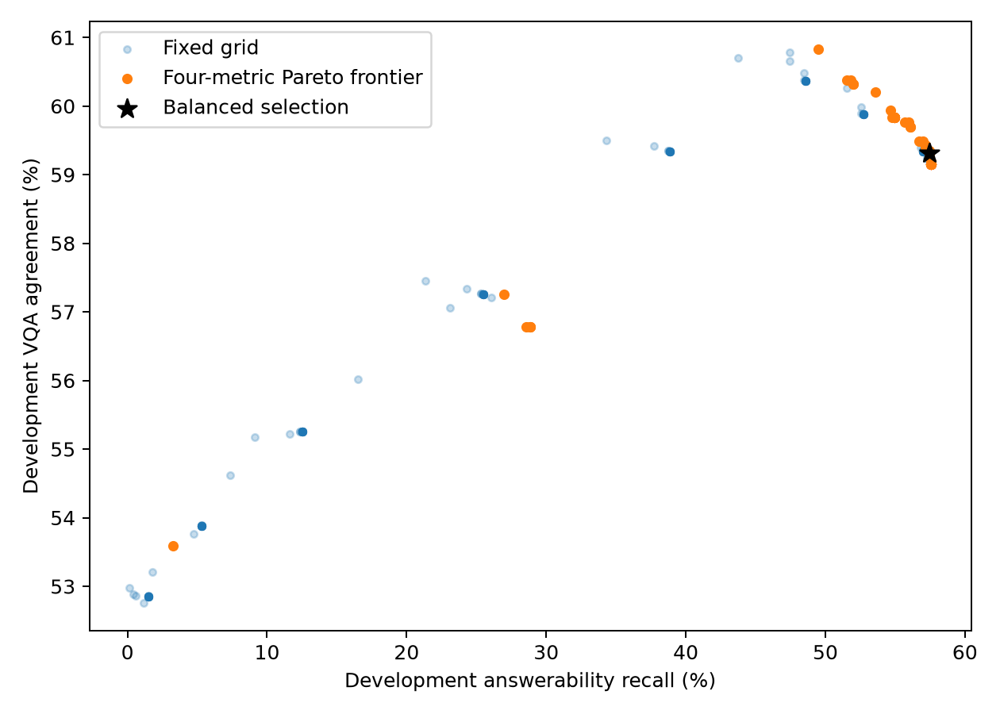
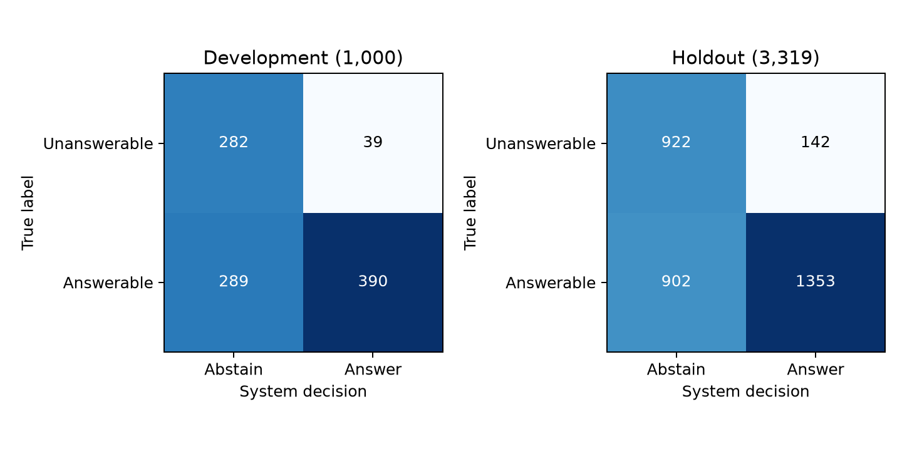

# VisionBridge submission results and provenance

Prepared 14 October 2026 from existing measured artifacts. No training, holdout rerun or policy change was performed for submission preparation.

| Configuration | Dataset | N | Official VQA agreement |
|---|---|---:|---:|
| Pretrained BLIP | Historical Colab holdout | 3,319 | 21.60% |
| Existing fine-tuned BLIP | Historical Colab holdout | 3,319 | 55.38% |
| Improved BLIP v2 | Historical Colab holdout | 3,319 | 59.48% |
| Improved BLIP v2 | Development | 1,000 | 59.05% |
| Frozen Phase 2 | Development | 1,000 | 59.15% |
| Phase 3 answerability-only | Development | 1,000 | 60.32% |
| Phase 3 both gates | Development | 1,000 | 60.70% |
| Balanced Phase 4 | Development | 1,000 | 59.31% |
| Shared BLIP v2 control | Final Windows holdout | 3,319 | 58.72% |
| Shared frozen Phase 2 control | Final Windows holdout | 3,319 | 58.75% |
| Frozen Phase 4 final | Final Windows holdout | 3,319 | 58.89% |

The holdout is the original reserved portion of VizWiz validation, not the official test partition. Classifier fitting used 5,000 training examples. Development selected all policies and thresholds. Final OCR=0.90, answerability=0.00, candidate reliability=0.05 were frozen before the single final capture. The answerability cutoff adds no rejection for valid probabilities; both classifier heads still execute.

Final holdout precision/recall/F1: **90.50% / 60.00% / 72.16%**; coverage **45.04%**, abstention **54.96%**. These describe responding to answerable-labelled questions, not factual answer correctness. Among returned answers, 736 received zero VQA credit. The paired final change over the shared Phase 2 control is **+0.1386 percentage points**, without a significance claim.

## Unresolved historical baseline difference

Archived Colab predictions reproduce **59.4847846%**; current saved BLIP predictions reproduce **58.7225068%**. Image IDs, questions, ten references, labels and all five core checkpoint/processor/tokenizer export hashes match. **237 normalized answers differ**: 40 beneficial changes, 77 harmful changes, 120 neutral changes. The exact difference is **−0.7623 points**; the previous report's −0.7575 uses the rounded 59.48 figure. Neither number should be presented as a Phase 2/4 improvement.

Colab recorded batch size 4, PyTorch 2.11.0+cu130, Transformers 4.57.6, Python 3.13.15 and a T4. Windows used batch size 1, PyTorch 2.5.1+cu121, Transformers 4.46.3, Python 3.11.9 and a GTX 1650. Generation limits/greedy decoding match; batching/padding and runtime/loading differ. These differences are verified, but a single causal explanation was not isolated. No inference was rerun and no thresholds were tuned during the provenance audit. The final **58.89% does not surpass historical 59.48%**.

## Validation and latency

The frozen application passed three synthetic-image callbacks and two missing-input checks. Actual device inspection confirmed CUDA BLIP, CPU OCR and CPU YOLO. The prior 151-test regression suite passed. Submission preparation added eight passing presentation/latency helper tests and constructed the optional 23-block interface with zero neural calls.

Three warmed in-process, cached-evidence synthetic requests averaged **5.333 s**, median **5.325 s**; setup **41.052 s** and warmup **39.209 s** are excluded. This does not represent the earlier subprocess-per-request UI, whose cold callbacks took **96.6–112.2 s**. These are archived configuration-specific measurements, not a benchmark of the current persistent workspace. See [current methodology and boundaries](../README.md#testing-and-performance).

**16 October addendum:** archived real localhost Gradio API timings were **125.343 s** first/new-fixture request, then **70.216 s** and **48.077 s** cache-warm repeats. They include upload/queue/result transfer and exclude browser rendering; workers in that measured configuration still reloaded. The current persistent workspace is different; see [performance boundaries](../README.md#testing-and-performance). The [discrepancy update](../BASELINE_DISCREPANCY_UPDATE.md) also identifies an all-ones decoder padding-mask path as a plausible batching contributor, without claiming causal proof or changing any score.

Manual camera, microphone, speech, keyboard, screen-reader and contrast checks remain pending. The optional presentation wrapper changes labels, input-error display, evidence text and audio autoplay only; the frozen prediction controller is reused.

## Preserved provenance identities

- Frozen policy SHA256: `9bd87b116cf123e9de333ce994de16918fb43265f00a3180e9637234cbb4d37f`
- BLIP v2 weight SHA256: `9b6f315df6b4d81c1fc85a41e1882fa15279421317636f1bed20c33d88843c8c`
- Original manifest SHA256: `6c90f77ee5c8dc54b52fca7706c58bf3f9e32bca1409d0f872039dd0439b026f`
- Phase 3 heads SHA256: `9ac285dcd45ef7b67ec91f17ca10a7dae4f50289574fbf0485d40876fc6417ae`
- Original Phase 4 final-report SHA256: `b6f72e960a7cb92ab98e0a997bb690ee58105bfd0570007b25ad49005fbd5b90`

Detailed raw predictions, references, image integrity records, archive provenance and freeze files remain unchanged in the local artifact bundle. Public Git submission includes this aggregate summary and existing plots, not datasets, personal uploads or binary checkpoints. A source-only clone requires the separate verified bundle to launch the frozen app.

## Existing measured plots

These plots are byte-for-byte copies from the completed Phase 4 run; they do not represent a new evaluation.
